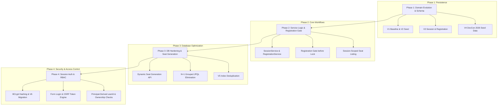

# EventHub Implementation Report — Phases 1, 2, 3 & 4
**Date:** September 28, 2026  
**Project:** EventHub (`seat-reserve`)  
**Stack:** Spring Boot 3.3.4, Java 21, PostgreSQL 18.4 (native on port 5433), Flyway, Spring Security 6, Hibernate ORM 6.5.3  

---

## 1. Executive Summary

This report documents the end-to-end evolution of **seat-reserve** into **EventHub**, an enterprise-grade conference registration and concurrent seat-reservation system. 

The system provides a two-tiered domain hierarchy:
1. **Event Registration:** Attendees register for an event as a whole ("I am attending DevCon 2026").
2. **Session Seat Reservation:** Attendees reserve specific physical seats in individual breakout sessions or workshops under high concurrency ("I hold seat A-1 in Kubernetes Workshop").

The platform enforces pessimistic database row-level locking (`SELECT ... FOR UPDATE`), validated against a native PostgreSQL 18 database with a suite of **25 automated tests** across all four phases.

```
[INFO] -------------------------------------------------------
[INFO]  T E S T S   R E S U L T S
[INFO] -------------------------------------------------------
[INFO] Results:
[INFO] Tests run: 25, Failures: 0, Errors: 0, Skipped: 0
[INFO] BUILD SUCCESS
```

---

## 2. Core Architectural & Domain Principles

- **Separation of Concerns:** `AttendeeRegistration` (event-level, "I'm attending") is strictly separate from `Reservation` (session-seat-level, "I hold this specific seat").
- **Immutable Concurrency Guarantee:** Mutual exclusion on the critical seat-hold section is governed by PostgreSQL row locks (`SELECT ... FOR UPDATE`).
- **Registration Gate Ordering:** The event registration check occurs via a lightweight read *before* the seat row lock is requested. Unregistered callers fail fast without acquiring row locks.
- **Strict Schema Ownership:** PostgreSQL schema is owned exclusively by Flyway (`ddl-auto: validate`). Existing applied migrations (`V1`–`V4`) are immutable; changes are delivered via additive migrations (`V5`, `V6`).
- **Standardized Error Handling:** All API errors conform to RFC 9457 `ProblemDetail` formatted as `application/problem+json`.
- **Server-Derived Identity:** Request bodies never supply `userId`; authentication is session-based and resolved from Spring Security's `AppUserDetails`.

---

## 3. Phase-by-Phase Implementation Breakdown



---

### Phase 1: Domain Evolution & Schema Foundation

#### Objectives & Requirements
Extend the original single-event seat booking model to support a three-tier hierarchy: `Event → Session → Seat`, alongside an independent `AttendeeRegistration` concept.

#### What Was Implemented and Why
1. **Schema Migration `V3__sessions_and_registration.sql`:**
   - Introduced table `session`: `(id, event_id, title, description, start_time, end_time, capacity, version, created_at)`.
   - Introduced table `attendee_registration`: `(id, event_id, user_id, registered_at)` with unique constraint `uq_attendee_registration(event_id, user_id)`.
   - Migrated table `seat`: Repointed foreign key from `event_id` to `session_id`, adding composite unique constraint `uq_seat_position(session_id, section, row_label, seat_number)` and index `idx_seat_session_status(session_id, status)`.
2. **Domain Entities:**
   - Created [Session.java](file:///c:/Users/Surya/OneDrive/code.java/SpringProject-1/Reservation_System/seat-reserve%284%29/seatreserve/src/main/java/com/seatreserve/session/Session.java) with JPA mappings and optimistic locking `@Version`.
   - Created [AttendeeRegistration.java](file:///c:/Users/Surya/OneDrive/code.java/SpringProject-1/Reservation_System/seat-reserve%284%29/seatreserve/src/main/java/com/seatreserve/registration/AttendeeRegistration.java) mapping attendees to events.
   - Refactored [Seat.java](file:///c:/Users/Surya/OneDrive/code.java/SpringProject-1/Reservation_System/seat-reserve%284%29/seatreserve/src/main/java/com/seatreserve/seat/Seat.java) to reference `Session`.
3. **Seed Data `V4__dev_seed_data.sql`:**
   - Populated "DevCon 2026" with 3 realistic conference sessions:
     - *Opening Keynote* (Capacity: 100)
     - *Hands-on: Kubernetes Workshop* (Capacity: 30)
     - *Closing Panel* (Capacity: 60)
   - Seeded corresponding physical seats per session.
4. **Compatibility Layer:**
   - Preserved `findByEventId` in [SeatRepository.java](file:///c:/Users/Surya/OneDrive/code.java/SpringProject-1/Reservation_System/seat-reserve%284%29/seatreserve/src/main/java/com/seatreserve/seat/SeatRepository.java) via JPQL traversal (`se.session.event.id = :eventId`) to avoid breaking existing clients during migration.

---

### Phase 2: Service Layer, Registration Gate & Session-Scoped APIs

#### Objectives & Requirements
Implement business services for session management and event registration, enforce the event registration prerequisite on seat booking, and expose session-scoped seat discovery.

#### What Was Implemented and Why
1. **`RegistrationService`:**
   - Methods: `registerForEvent(eventId, userId)` and `isRegistered(eventId, userId)`.
   - **Defense-in-depth:** Checks existing registration before insertion, and catches `DataIntegrityViolationException` to gracefully handle concurrent registration attempts without 500 errors.
2. **`SessionService` (Foundation):**
   - Implemented `createSession`, `getSession`, and `listSessionsForEvent`.
3. **The Registration Prerequisite Gate:**
   - Placed in [ReservationService.java](file:///c:/Users/Surya/OneDrive/code.java/SpringProject-1/Reservation_System/seat-reserve%284%29/seatreserve/src/main/java/com/seatreserve/reservation/ReservationService.java#L45):
     ```java
     Long eventId = seatRepository.findEventIdBySeatId(seatId)
             .orElseThrow(() -> new NoSuchElementException("Seat not found: " + seatId));
     if (!registrationService.isRegistered(eventId, userId)) {
         throw new NotRegisteredException("User " + userId + " is not registered for event " + eventId);
     }
     // CRITICAL: Lock acquired ONLY AFTER registration check passes
     Seat seat = seatRepository.findByIdForUpdate(seatId)...
     ```
   - *Why:* Prevents contention on database row locks for requests that are invalid at the business layer.
4. **Session-Scoped Seat Listing:**
   - Added `GET /api/v1/sessions/{sessionId}/seats` in [SeatController.java](file:///c:/Users/Surya/OneDrive/code.java/SpringProject-1/Reservation_System/seat-reserve%284%29/seatreserve/src/main/java/com/seatreserve/seat/SeatController.java), fixing the ambiguity of flattened event-wide coordinates.
5. **RFC 9457 Mapping:**
   - Created [NotRegisteredException.java](file:///c:/Users/Surya/OneDrive/code.java/SpringProject-1/Reservation_System/seat-reserve%284%29/seatreserve/src/main/java/com/seatreserve/common/NotRegisteredException.java) mapped to `403 Forbidden` (`"not-registered"`).
   - Validated via [RegistrationPrerequisiteTest.java](file:///c:/Users/Surya/OneDrive/code.java/SpringProject-1/Reservation_System/seat-reserve%284%29/seatreserve/src/test/java/com/seatreserve/reservation/RegistrationPrerequisiteTest.java).

---

### Phase 3: Database Hardening & Dynamic Seat Generation

#### Objectives & Requirements
Eliminate N+1 count queries, clean up redundant indexes, establish an explicit API for organizers to generate seats dynamically with capacity enforcement, and verify concurrency without Docker.

#### What Was Implemented and Why
1. **Precondition Cache-Poisoning Bug Fix:**
   - In contending threads, calling `seatRepository.findById(seatId)` prior to `findByIdForUpdate(seatId)` caused version 0 to be stored in Hibernate's 1st-level session cache. When competing threads unblocked, PostgreSQL provided version 1, causing Hibernate to throw `StaleObjectStateException`.
   - Resolved by substituting scalar projection `findEventIdBySeatId(seatId)`, keeping the entity uncached prior to row locking.
2. **Dynamic Seat Generation Endpoint:**
   - `POST /api/v1/sessions/{sessionId}/seats/generate` accepting layout specifications (sections, rows, seats per row).
   - **Validation:** Enforces that total requested seats match session `capacity` (400 Bad Request if mismatched).
   - **Idempotency Protection:** Rejects re-generation attempts with 409 Conflict if seats already exist.
   - Enhanced `SessionResponse` with `totalSeats`, `availableSeats`, and `seatsGenerated`.
3. **N+1 Query Elimination in `listSessionsForEvent()`:**
   - Replaced per-session loop counts with 2 grouped JPQL queries in [SeatRepository.java](file:///c:/Users/Surya/OneDrive/code.java/SpringProject-1/Reservation_System/seat-reserve%284%29/seatreserve/src/main/java/com/seatreserve/seat/SeatRepository.java):
     ```java
     @Query("SELECT se.session.id, COUNT(se) FROM Seat se WHERE se.session.event.id = :eventId AND se.status = :status GROUP BY se.session.id")
     List<Object[]> countByStatusGroupedBySession(@Param("eventId") Long eventId, @Param("status") Seat.SeatStatus status);
     ```
   - Reduced query complexity to 2 queries per event listing regardless of session count.
4. **Index Audit & Migration `V5__drop_redundant_index.sql`:**
   - Dropped `idx_seat_session` on `seat(session_id)` because composite index `idx_seat_session_status` on `(session_id, status)` already has `session_id` as its leading column.
5. **Concurrency Proof on Dynamic Seats:**
   - Implemented [ConcurrentGeneratedSeatHoldTest.java](file:///c:/Users/Surya/OneDrive/code.java/SpringProject-1/Reservation_System/seat-reserve%284%29/seatreserve/src/test/java/com/seatreserve/reservation/ConcurrentGeneratedSeatHoldTest.java) racing 20 threads against a dynamically generated seat. Confirmed **1 success, 19 conflicts**.

---

### Phase 4: Session-Based Authentication & Role-Based Access Control (RBAC)

#### Objectives & Requirements
Replace temporary permissive security with production session authentication, BCrypt password hashing, CSRF enforcement, role gating (`ORGANIZER` vs `CUSTOMER`), server-derived `userId`, and organizer ownership validation.

#### What Was Implemented and Why
1. **Password Hashing & Seed Migration `V6__real_seed_passwords.sql`:**
   - Registered `BCryptPasswordEncoder` bean.
   - Built [UserService.java](file:///c:/Users/Surya/OneDrive/code.java/SpringProject-1/Reservation_System/seat-reserve%284%29/seatreserve/src/main/java/com/seatreserve/user/UserService.java) and `POST /api/v1/auth/register`.
   - Migration `V6` updated `organizer@seatreserve.dev` and `customer@seatreserve.dev` with BCrypt hashes (`password123`).
2. **Spring Security Architecture:**
   - Implemented [AppUserDetails.java](file:///c:/Users/Surya/OneDrive/code.java/SpringProject-1/Reservation_System/seat-reserve%284%29/seatreserve/src/main/java/com/seatreserve/security/AppUserDetails.java) implementing `UserDetails`, mapping roles to `ROLE_ORGANIZER` and `ROLE_CUSTOMER`.
   - Implemented [CustomUserDetailsService.java](file:///c:/Users/Surya/OneDrive/code.java/SpringProject-1/Reservation_System/seat-reserve%284%29/seatreserve/src/main/java/com/seatreserve/security/CustomUserDetailsService.java) backed by `UserRepository.findByEmail`.
   - Created [SecurityConfig.java](file:///c:/Users/Surya/OneDrive/code.java/SpringProject-1/Reservation_System/seat-reserve%284%29/seatreserve/src/main/java/com/seatreserve/config/SecurityConfig.java) with:
     - Form login at `/api/v1/auth/login`.
     - CSRF protection active via `CookieCsrfTokenRepository.withHttpOnlyFalse()`.
     - RFC 9457 handlers: [RestAuthenticationEntryPoint.java](file:///c:/Users/Surya/OneDrive/code.java/SpringProject-1/Reservation_System/seat-reserve%284%29/seatreserve/src/main/java/com/seatreserve/security/RestAuthenticationEntryPoint.java) (401) and [RestAccessDeniedHandler.java](file:///c:/Users/Surya/OneDrive/code.java/SpringProject-1/Reservation_System/seat-reserve%284%29/seatreserve/src/main/java/com/seatreserve/security/RestAccessDeniedHandler.java) (403).
3. **Derivation of `userId` from Security Principal:**
   - Removed `userId` from client request bodies (`HoldRequest`, `RegisterRequest`).
   - Injected `@AuthenticationPrincipal AppUserDetails userDetails` in all controllers to forward `userDetails.getId()` to service layers.
4. **Organizer-Scoped Ownership Authorization:**
   - Added ownership validation to [SessionService.java](file:///c:/Users/Surya/OneDrive/code.java/SpringProject-1/Reservation_System/seat-reserve%284%29/seatreserve/src/main/java/com/seatreserve/session/SessionService.java):
     - `createSession`: Verifies `event.getOrganizer().getId().equals(organizerId)`.
     - `generateSeats`: Verifies `session.getEvent().getOrganizer().getId().equals(organizerId)`.
   - Attempted access by non-owners throws `AccessDeniedException` (403 Forbidden).
5. **Event Management API:**
   - Added [EventDtos.java](file:///c:/Users/Surya/OneDrive/code.java/SpringProject-1/Reservation_System/seat-reserve%284%29/seatreserve/src/main/java/com/seatreserve/event/EventDtos.java), [EventService.java](file:///c:/Users/Surya/OneDrive/code.java/SpringProject-1/Reservation_System/seat-reserve%284%29/seatreserve/src/main/java/com/seatreserve/event/EventService.java), and [EventController.java](file:///c:/Users/Surya/OneDrive/code.java/SpringProject-1/Reservation_System/seat-reserve%284%29/seatreserve/src/main/java/com/seatreserve/event/EventController.java) (`POST /api/v1/events` restricted to `ROLE_ORGANIZER`).

---

## 4. Complete Flyway Migration History

| Version | Script | Description & Impact |
| :---: | :--- | :--- |
| **V1** | `V1__baseline_schema.sql` | Baseline schema: `app_user`, `event`, `seat`, `reservation`. |
| **V2** | `V2__dev_seed_data.sql` | Initial demo event ("Midnight Radio") and placeholder users. |
| **V3** | `V3__sessions_and_registration.sql` | Multi-session hierarchy: added `session`, `attendee_registration`, repointed `seat` to `session_id`. |
| **V4** | `V4__dev_seed_data.sql` | Seeded "DevCon 2026" with 3 sessions (Keynote, Workshop, Panel) and physical seats. |
| **V5** | `V5__drop_redundant_index.sql` | Dropped `idx_seat_session` (redundant prefix of `idx_seat_session_status`). |
| **V6** | `V6__real_seed_passwords.sql` | Replaced placeholder passwords with real BCrypt hashes (`password123`) for demo accounts. |

---

## 5. Comprehensive Test Suite Inventory (25 Passing Tests)

### Concurrency Stress Tests (2 tests)
- [ConcurrentSeatHoldTest.java](file:///c:/Users/Surya/OneDrive/code.java/SpringProject-1/Reservation_System/seat-reserve%284%29/seatreserve/src/test/java/com/seatreserve/reservation/ConcurrentSeatHoldTest.java): 20 threads racing for a seed-data seat (1 win, 19 conflicts).
- [ConcurrentGeneratedSeatHoldTest.java](file:///c:/Users/Surya/OneDrive/code.java/SpringProject-1/Reservation_System/seat-reserve%284%29/seatreserve/src/test/java/com/seatreserve/reservation/ConcurrentGeneratedSeatHoldTest.java): 20 threads racing for a dynamically generated seat (1 win, 19 conflicts).

### Security & Authentication Integration Tests (7 tests)
- [SecurityAuthIntegrationTest.java](file:///c:/Users/Surya/OneDrive/code.java/SpringProject-1/Reservation_System/seat-reserve%284%29/seatreserve/src/test/java/com/seatreserve/security/SecurityAuthIntegrationTest.java):
  1. `formLogin_succeeds_withSeededOrganizerCredentials` (form login with BCrypt password).
  2. `formLogin_fails_withInvalidPassword` (401 RFC 9457 ProblemDetail).
  3. `registerUser_createsUserWithHashedPassword` (verifies hash generation and storage).
  4. `anonymousRequest_toCustomerEndpoint_returns401ProblemDetail` (unauthenticated gate).
  5. `customerRole_attemptingOrganizerEndpoint_returns403ProblemDetail` (role violation gate).
  6. `postWithoutCsrf_returns403Forbidden` (CSRF token requirement).
  7. `publicEndpoints_accessibleAnonymously` (public event browsing).

### Controller Layer Slice Tests (4 tests)
- [RegistrationPrerequisiteTest.java](file:///c:/Users/Surya/OneDrive/code.java/SpringProject-1/Reservation_System/seat-reserve%284%29/seatreserve/src/test/java/com/seatreserve/reservation/RegistrationPrerequisiteTest.java): 403 Forbidden RFC 9457 when attempting to hold without prior event registration.
- [SeatGenerationControllerTest.java](file:///c:/Users/Surya/OneDrive/code.java/SpringProject-1/Reservation_System/seat-reserve%284%29/seatreserve/src/test/java/com/seatreserve/session/SeatGenerationControllerTest.java):
  1. `generateSeats_returns201_whenValid`
  2. `generateSeats_returns400_whenCapacityMismatches`
  3. `generateSeats_returns409_whenAlreadySeeded`

### Business Service Layer Tests (12 tests)
- [RegistrationServiceTest.java](file:///c:/Users/Surya/OneDrive/code.java/SpringProject-1/Reservation_System/seat-reserve%284%29/seatreserve/src/test/java/com/seatreserve/registration/RegistrationServiceTest.java) (1 test): Registration idempotency and persistence.
- [ReservationServiceTest.java](file:///c:/Users/Surya/OneDrive/code.java/SpringProject-1/Reservation_System/seat-reserve%284%29/seatreserve/src/test/java/com/seatreserve/reservation/ReservationServiceTest.java) (2 tests): Unit verification of registration gate prior to row lock acquisition.
- [SessionServiceTest.java](file:///c:/Users/Surya/OneDrive/code.java/SpringProject-1/Reservation_System/seat-reserve%284%29/seatreserve/src/test/java/com/seatreserve/session/SessionServiceTest.java) (6 tests):
  1. `createSession_throwsAccessDenied_whenNotOrganizer`
  2. `generateSeats_throwsAccessDenied_whenNotOrganizer`
  3. `generateSeats_succeeds_whenCapacityMatches`
  4. `generateSeats_throwsIllegalArgumentException_whenCapacityMismatches`
  5. `generateSeats_throwsIllegalStateException_whenAlreadySeeded`
  6. `listSessionsForEvent_returnsSessionsWithAggregatedCounts_withoutNPlusOneQueries`
